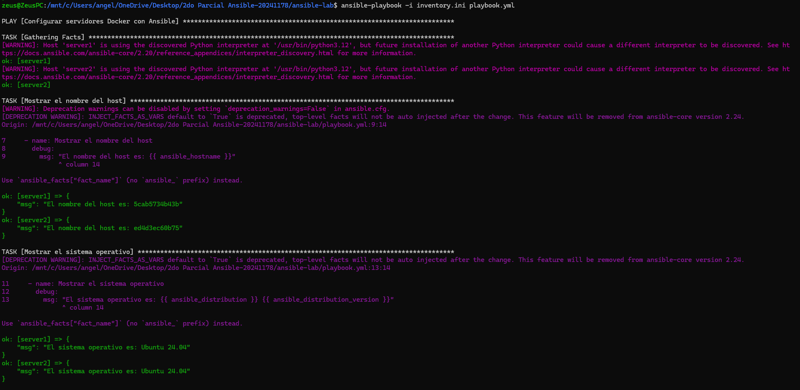

# Laboratorio Ansible con Docker

## Objetivo de la práctica

Crear un laboratorio con dos servidores Linux (contenedores Docker basados en Ubuntu 24.04) y administrarlos mediante Ansible.

El playbook realiza en ambos servidores las siguientes tareas:

- Mostrar el nombre del host.
- Mostrar el sistema operativo.
- Crear el directorio `/tmp/ansible-demo`.
- Crear el archivo `info.txt`.
- Escribir en `info.txt` el nombre del servidor y el sistema operativo.
- Crear mediante un loop los directorios `logs`, `backup` y `config`.
- Mostrar un mensaje únicamente cuando el sistema operativo sea Ubuntu.

## Estructura del repositorio

```
ansible-lab/
├── docker-compose.yml
├── inventory.ini
├── playbook.yml
└── README.md
```

## Comandos para iniciar los contenedores

Desde la carpeta `ansible-lab`:

```bash
docker compose up -d
docker ps
```

Instalar Python3 en cada contenedor:

```bash
docker exec -it server1 bash
apt update
apt install -y python3
exit

docker exec -it server2 bash
apt update
apt install -y python3
exit
```

## Comprobación de conexión

```bash
ansible docker -i inventory.ini -m ping
```

## Comando para ejecutar el playbook

```bash
ansible-playbook -i inventory.ini playbook.yml
```

## Resultado de la ejecución

A continuación se muestra la captura de pantalla de la ejecución exitosa del playbook:



FALTAN MAS CAPTURAS, ESTAN DENTRO DE LA CARPETA DOCS

## Requisitos previos

- Docker (Engine o Desktop) con `docker compose`
- Ansible instalado en la máquina de control
- Python3 instalado dentro de los contenedores
